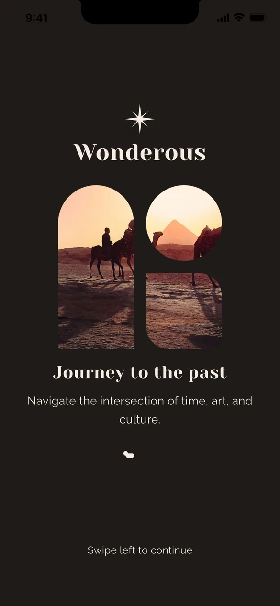
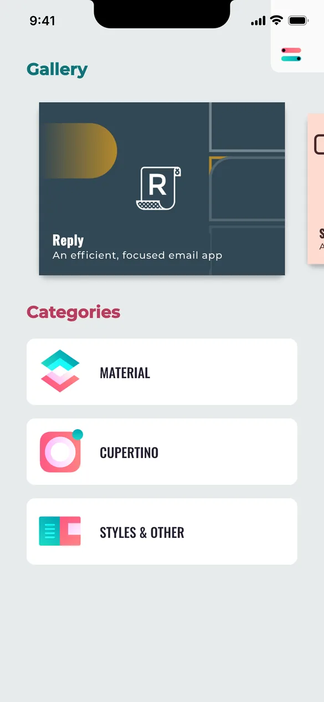

# Pomme

Pomme is an iOS emulator. It runs iPhone and iPad apps on Windows, Linux and
Mac, or in your web browser. Open your app and use it like a real iPhone: tap,
scroll, type, and try different screen sizes and languages.

Website: **[trypomme.dev](https://trypomme.dev)**

   

Shown: [Wonderous](https://github.com/gskinnerTeam/flutter-wonderous-app) by
gskinner (MIT) and [Flutter Gallery](https://github.com/flutter/gallery) by the
Flutter team (BSD-3), running in Pomme.

## What can it run?

- Apps you build yourself: development, ad hoc and release builds from Xcode
  or EAS, as an `.ipa` or `.app` file.
- Apps made with **Expo, React Native and Flutter** work best today. Apps
  written only in Swift with UIKit or SwiftUI partly work.
- Apps from the **App Store or TestFlight can't run**, because Apple encrypts
  them.

You don't need a Mac to run an app in Pomme. You still need a Mac (or a cloud
build service such as EAS) to build the app.

## Download

Download Pomme for your computer from the latest release:

| Computer | Download |
| --- | --- |
| Mac (Apple silicon) | [pomme-macos-arm64.zip](https://github.com/trypomme/pomme/releases/latest/download/pomme-macos-arm64.zip) |
| Windows (64-bit) | [pomme-windows-x64.zip](https://github.com/trypomme/pomme/releases/latest/download/pomme-windows-x64.zip) |
| Linux (x64) | [pomme-linux-x64.tar.gz](https://github.com/trypomme/pomme/releases/latest/download/pomme-linux-x64.tar.gz) |
| Linux (Arm) | [pomme-linux-arm64.tar.gz](https://github.com/trypomme/pomme/releases/latest/download/pomme-linux-arm64.tar.gz) |

All downloads, with checksums, are on the
[Releases page](https://github.com/trypomme/pomme/releases).

To try Pomme without downloading anything, open the
[demo in your browser](https://trypomme.dev/demo/).

## Run your app

1. Unzip the download. Keep the `sysroot` folder next to the `pomme` program.
2. Open a terminal in that folder.
3. Run your app:

   ```bash
   ./pomme run MyApp.ipa --window
   ```

   On Windows, type `pomme.exe` instead of `./pomme`. Your app opens in a
   window that looks like an iPhone.

Some other useful commands:

```bash
./pomme run MyApp.ipa --window --device iphone-se    # a different iPhone
./pomme run MyApp.ipa --window --language ja-JP      # a different language
./pomme coverage MyApp.ipa                           # what your app needs that Pomme doesn't have yet
./pomme --help                                       # every command and option
```

The [FAQ](https://trypomme.dev/faq/) answers common questions. Where Pomme
behaves differently from a real iPhone is in
[docs/differences-from-ios.md](https://github.com/trypomme/pomme/blob/main/docs/differences-from-ios.md).

## Build from source

Pomme is written in Rust.

1. Install [Rust](https://rustup.rs).
2. Get the code:

   ```bash
   git clone https://github.com/trypomme/pomme.git
   cd pomme
   ```

3. Get the *sysroot*. This is the open-source part of iOS (the Swift runtime,
   CoreFoundation, fonts and more) that apps load.
   - On a Mac with Xcode: `scripts/build-sysroot.sh` builds it into
     `vendor/sysroot` (about 600 MB and 10 minutes).
   - On Windows or Linux: copy the `sysroot` folder from a
     [download](#download) to `vendor/sysroot`.
4. Run your app:

   ```bash
   cargo run --release -- run MyApp.ipa --window
   ```

To build the browser version, run the tests, or change Pomme itself, read
[docs/development.md](https://github.com/trypomme/pomme/blob/main/docs/development.md).

## Licence

Pomme is open source under the [MIT licence](https://github.com/trypomme/pomme/blob/main/LICENSE).

A few files in this repository come from other projects and keep their own
licences. They are all permissive, so you can use them alongside Pomme's MIT
licence:

- `apps/hello-expo-font/assets/fonts/`: the Roboto and Roboto Slab fonts,
  under the Apache License 2.0 (see the `LICENSE.md` file in that folder).
- `crates/pomme-cli/tests/fixtures/ytplayer/`: Google's YouTube player helper,
  used as a test app, under the Apache License 2.0.
- `scripts/sysroot/*.patch`: changes to Apple's open source
  [swift-foundation](https://github.com/swiftlang/swift-foundation) and
  [swift-corelibs-foundation](https://github.com/swiftlang/swift-corelibs-foundation),
  under the Apache License 2.0 with the Runtime Library Exception, like the
  code they change.

Pomme is not affiliated with Apple. iPhone, iPad and iOS are trademarks of
Apple Inc.
