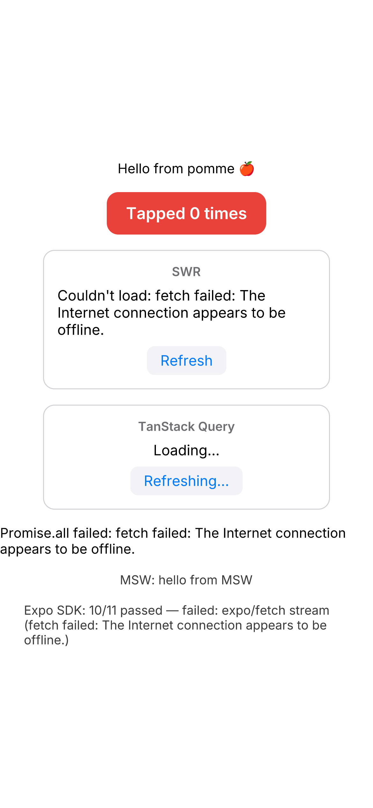
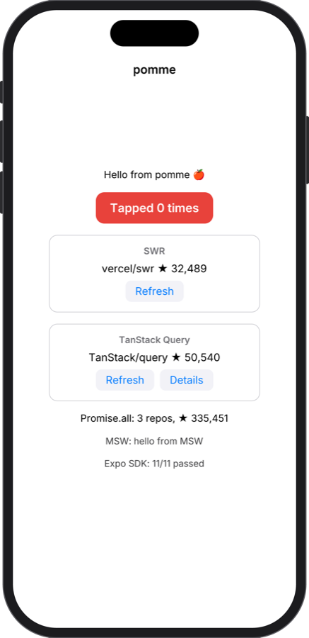
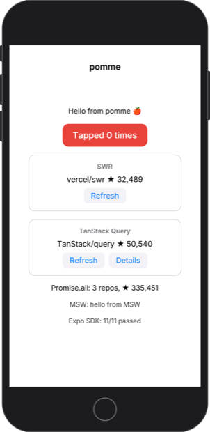
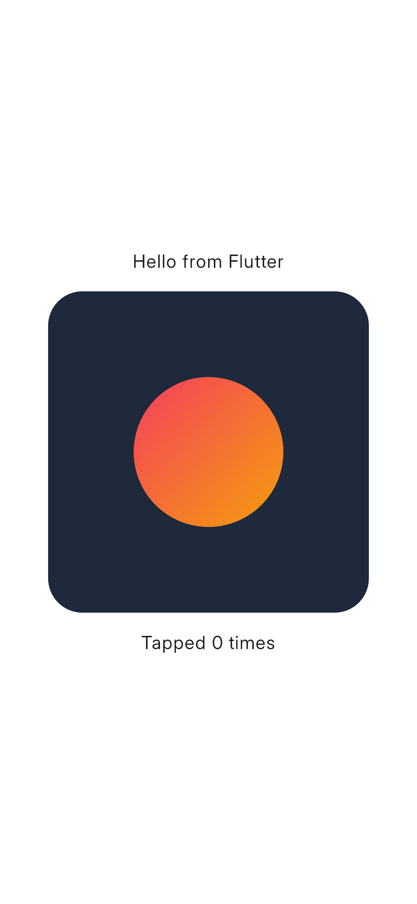
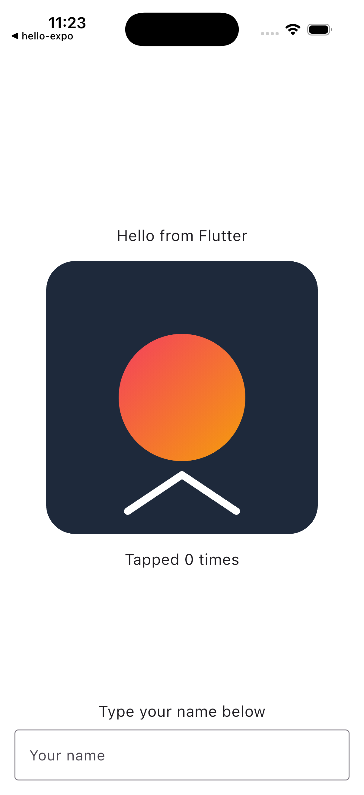

# pomme

A Rust emulator for running iOS apps on other platforms (web via WASM, Windows),
in the spirit of DOSBox: emulate the arm64 CPU and provide high-level
replacements (HLE) for the iOS system libraries the app calls into.

## Layout

| Path | What |
| --- | --- |
| `crates/pomme-macho` | Mach-O parsing: segments, dylibs, imports, fixups (chained + dyld_info), export trie. |
| `crates/pomme-loader` | Our `dyld`: maps the app and its bundled frameworks into guest memory and links them. System libraries found in the sysroot are loaded as guest code; every other system symbol binds to a trapping HLE stub. |
| `crates/pomme-mem` | Guest address space shared by the loader and CPU. |
| `crates/pomme-hle` | pomme's own system libraries, in Rust: stub dispatch and image initializers, a deterministic heap, an Objective-C runtime (classes from the app's metadata, synthesized system classes, `objc_msgSend`, reflection and Swift hooks), most of the libSystem the app and runtimes use (strings, libm, printf, time, dispatch, TLS, dyld queries), and the first bits of Foundation and UIKit. |
| `vendor/sysroot` | (built, not committed) Open-source system libraries compiled for arm64 and run as guest code: the Swift runtime, libc++, CoreFoundation with ICU, and Swift Foundation (swift-foundation built as module `Foundation`, plus pomme's Objective-C bridging overlay in `scripts/sysroot/swift-foundation-overlay`). See `scripts/build-sysroot.sh`; `scripts/sysroot/` holds the small shims and patch CoreFoundation needs. |
| `crates/pomme-cpu` | arm64 user-mode interpreter: integer, loads/stores, atomics, scalar FP and a NEON lane engine. Deterministic; instruction count is the clock. |
| `crates/pomme-cli` | `pomme` command-line tool. |
| `apps/hello-expo` | Skeleton Expo app — the first guest we want to boot. |
| `scripts/` | Build helpers. |

## Try it

```bash
scripts/build-hello-expo.sh            # needs the iOS platform installed in Xcode
scripts/build-sysroot.sh               # Swift runtime, libc++, CoreFoundation + ICU from source (~600 MB, ~10 min)
cargo run -- inspect apps/hello-expo/ios/build/Build/Products/Release-iphoneos/helloexpo.app
cargo run -- load    apps/hello-expo/ios/build/Build/Products/Release-iphoneos/helloexpo.app
cargo run -- run     apps/hello-expo/ios/build/Build/Products/Release-iphoneos/helloexpo.app --tap 195,438@3 --views --screenshot hello.png
scripts/build-web.sh && scripts/serve-web.py   # the same app in the browser: http://127.0.0.1:8787
cargo test           # fixture tests build tiny iOS binaries; need Xcode + iOS SDK
```

`inspect` lists every image in the bundle and the **HLE surface**: the system
libraries and symbols pomme has to implement for the app to run.

## MVP

Open hello-expo's `.app` on a machine with **no Apple software behind it**
(Windows, Linux, a browser tab) and see it render and respond to taps — like
DOSBox or SameBoy. Every system library the app touches is pomme's own code.
(Building the `.app` still needs Xcode, once, e.g. in CI.)

Debugging:
- `pomme run … --views` prints the view hierarchy (class, frame, colours, text) when the run stops;
  `--seconds N` stops once the app is idle past N seconds of virtual time (default 10).
- `pomme run … --trace` prints system calls, messages, thread switches and Mach traffic.
- `pomme run … --url 'scheme:///path'` launches with a deep link, as iOS passes one;
  `--type 'Ada\n@4'` types on the software keyboard at 4 s (`\n` return, `\b` delete) into
  whatever has focus (tap a text field first with `--tap`). The keyboard reports iOS 26's
  frame (335 pt, measured in the Simulator) with the usual will/did notifications.
  Multiline input works too: `UITextView` (React Native's `multiline` TextInput) wraps its
  lines, takes return as a newline and scrolls to keep the caret in sight, and Flutter's
  multiline TextField breaks lines (it finds its ICU data in Flutter.framework's bundle).
- `--swipe 195,700>195,300@3` drags from one point to another at 3 s (0.3 s; `@3~0.1` for a
  faster fling). Scroll views scroll the way UIKit's do: a 10 pt start, rubber-banding past
  the edges, then deceleration at UIKit's rate after a flick, with the delegate calls apps
  hear (React Native's `onScroll`, FlatList's lazy rows, snapping). Flutter scrolls its own
  lists from the touches. Tests script the same with `touch::swipe` / `touch::tap`.
  Gesture recognizers follow UIKit's rules: `UIPanGestureRecognizer` begins after 10 pt
  and reports translation and velocity, a recognizer that begins stops the others on its
  touches (unless their delegates allow both), and `allowedTouchTypes` is honoured — enough
  for react-native-gesture-handler's pan and tap gestures.
- The clipboard: `--clipboard host` shares this machine's clipboard with the app (paste in
  what you copied; the app's copies land here); `--clipboard 'some text'` starts it with
  text, and the default is empty, so runs repeat. `--paste 'Ada@4'` pastes "Ada" (copied by
  another app) into whatever has focus at 4 s; `--paste '@4'` pastes what's there. Reads
  of another app's text count iOS's "Allow Paste" prompts, answered by
  `--paste-permission allow|deny`; tests drive the same through `emu.clipboard`.
- `pomme run … --device iphone-17-pro-max` presents another iPhone: its screen size and scale,
  safe area, keyboard height, and its notch or Dynamic Island in screenshots
  (`--device list` lists them; the default is the iPhone 16e). `--shell` draws the
  screenshot inside a plain phone body: rounded screen corners, bezel, buttons, home button.
  The iPhone 17's frame matches the iOS 26 Simulator's, island included.
  Native apps get Auto Layout against the device: anchors and `NSLayoutConstraint`,
  `safeAreaLayoutGuide`, `layoutMarginsGuide`, `keyboardLayoutGuide` and their own guides,
  with `safeAreaInsetsDidChange` / `viewSafeAreaInsetsDidChange` when insets change
  (a propagating solver, not Cassowary: pinning, centering and fixed or proportional sizes).
- `POMME_BREAK=_sym1,Image:0xaddr,… pomme run …` prints every call to those guest functions —
  local (non-exported) ones too, by name or by the address `nm` prints.
- C++ exceptions unwind for real: libunwind is built into the sysroot (iOS's
  `/usr/lib/system/libunwind.dylib`), so throws are caught where the app catches them,
  destructors and all. An exception that would unwind through pomme's own code (a system
  call that called back into the app) stops the run, saying so.
- `pomme run … --profile out.json` profiles the app's code: every 10,000 instructions
  (`--profile-every N`) it records the running thread's whole stack, through pomme's own
  functions where the app called into the system and was called back. When the run stops it
  writes `out.json` for [speedscope](https://www.speedscope.app) (flame chart, left-heavy and
  sandwich views, one profile per thread) and prints the functions with the most
  instructions. Names are demangled. Time is in instructions, the guest's clock, so the same
  run profiles the same way every time; what pomme's own code costs in wall time isn't in it
  (profile the `pomme` binary itself for that, e.g. with samply or Instruments).
- `os_log` output (including React Native's and Expo's logs) is printed as `[os_log …]`.
- Web views: `WKWebView` (its configuration, user content controller and script messages,
  navigation and UI delegates, `loadHTMLString:baseURL:`, `loadRequest:`, `evaluateJavaScript:`)
  is pomme's, and its pages run in a web engine the front end provides (`webkit::WebEngine`),
  as iOS runs them in WebKit's own process. Every navigation, the app's own loads included,
  goes to the navigation delegate first, so pages that call home through made-up URLs
  (`ytplayer://onReady`) work. On macOS the engine is the Mac's own WebKit, in the
  `pomme-webview` helper pomme starts (built beside `pomme`; `crates/pomme-webview`): one real
  web view per page, in a window that's never on screen, snapshotted ~30 times a second
  whenever it changes, so the page is drawn into the phone's screen with everything else
  (views above cover it; screenshots and recordings have it, video included). Virtual time
  keeps to the wall clock while pages run. Pages see the Mac's WebKit, not an iPhone's (as an
  iPad's web views present themselves): pages built for iPhones can rely on what only iPhones
  have (YouTube's mobile player won't play). In the browser (`scripts/build-web.sh`) pages
  are the browser's own frames, under the screen's canvas where pomme leaves a hole
  (`web/webview.js`): a page the app builds is the frame's document, its navigations put to
  the delegate through the Navigation API, scriptable, with message handlers; input over an
  uncovered page is the page's. There a page belongs to pomme's site, not its base URL, so
  frames in it that answer only the base URL's origin (YouTube's player, given an `origin`)
  never answer; another site's page shows but can't be scripted. Elsewhere pages don't
  load yet (each load fails, as WebKit's would). Tests script a page with `webkit::Scripted`;
  `tests/webkit.rs` runs Google's YouTube player helper against one, and a web view app in
  the Mac's WebKit (`POMME_ONLINE=1` also plays a real YouTube video). `--trace` shows the
  traffic as `[webkit]`, and the pages' console. Touches on a page reach it as on iOS: a tap
  is a click there, a drag scrolls. Not yet: file URLs, popups, Windows and Linux.
- `POMME_WATCH=0xaddr,… pomme run …` reports who allocated those heap addresses.
- `POMME_BREAK_VREGS=1` adds registers (vector too) to each break; `POMME_BREAK_MEM=x1:8`
  dumps memory at a register. Breakpoints can sit mid-function (`Image:0xaddr`).
- `POMME_DUMP_IMAGES=dir` writes every image the app renders (`UIGraphicsImageRenderer`) as PNG.
- Every stop prints the failing thread, its registers and a backtrace; C++ exceptions are reported with their type and `what()`.



 

## Targets

What pomme aims to run, and the iOS graphics path each one takes.

| App kind | Renders through | Test app | Status |
|---|---|---|---|
| Expo / React Native | UIKit views + Core Animation (pomme's compositor) | `apps/hello-expo` | ✅ runs, taps, scrolls (FlatList), Expo Router, TextInput (multiline too) + KeyboardAvoidingView, gesture handler, Reanimated + keyboard controller |
| React Native Skia | Skia Ganesh → Metal (→ wgpu) | `apps/hello-skia` | ✅ renders like the simulator |
| Flutter (Impeller, 3.27+) | Impeller → Metal; text via CoreText | `apps/hello-flutter` | ✅ renders, counts taps, TextField with the keyboard inset; matches the iOS Simulator to 3/255 except the font |
| Flutter (Skia era, older) | Skia → Metal | — | planned |
| Defold | Vulkan → MoltenVK → Metal (older builds: OpenGL ES) | — | planned: needs MoltenVK's runtime MSL, maybe GLES |
| Native UIKit / SwiftUI | UIKit, Core Animation, Metal | — | later |

Flutter in pomme (left) and in the iOS Simulator on an iPhone 17 (right). Offset to the same
center, the page, square and stroked chevron are identical, and the gradient circle differs by at
most 3/255 (Impeller's gradient dithering). The text differs only in typeface: the system font is SF Pro on iOS, and pomme
draws it with Inter because SF Pro can't be redistributed.

 

## Rough roadmap

1. Inspect guest binaries ✅
2. Loader: map segments, apply fixups, bind system imports to HLE stubs ✅
3. CPU: arm64 user-mode interpreter, trap on HLE stubs ✅ (runs hello-expo's `main` to `UIApplicationMain`)
4. System libraries:
   - Objective-C runtime (HLE) ✅
   - Swift runtime and libc++, built from source into the sysroot ✅
   - libSystem (HLE): the common parts ✅; files, sockets, threads, C++ exceptions still to do
   - image initializers (`+load`, static constructors) before `main` ✅
   - CoreFoundation, built from source, with Foundation's collection, string and number classes
     bridged to it toll-free ✅
   - Swift Foundation from source, with Swift ↔ Objective-C bridging ✅ — **hello-expo finishes
     launching**: ~1.6M instructions through initializers, Expo, React Native setup and
     `application:didFinishLaunchingWithOptions:`
   - UIKit, first pass ✅: scene connection from the Info.plist manifest, `UIScreen`, `UIWindow`,
     `UIView` (state kept host-side, keyed by object), `UIViewController`, `UIColor` — hello-expo's
     `SceneDelegate` creates its window and React Native starts creating the Hermes runtime
     (~2.0M instructions)
   - Threads ✅: guest threads with their own registers, stacks, TLS and thread-specific data,
     switched cooperatively at blocking points (Mach-port receives, semaphores, condition
     variables, joins, sleeps) plus a fixed instruction quantum; virtual time skips ahead when
     every thread waits. Minimal Mach ports and messages, so CoreFoundation's real run loops sleep
     and wake. `NSThread`, pthreads, cross-thread `performSelector`, `NSRunLoop`, `CADisplayLink`
   - More Foundation: NSData, NSDate, NSFileManager, NSUserDefaults (in memory), notifications,
     compile-time literals, system data constants; a read-only virtual filesystem for the app
     bundle — hello-expo runs ~8.6M instructions on three threads (main, React Native's JS
     thread, Hermes's GC thread): Hermes is up and React Native is installing native modules
   - Swift overlays ✅ from Apple's open-source sources (`ObjectiveC`, `Darwin`, `Dispatch`, `os`,
     `CoreFoundation` with `CGFloat`, `CoreGraphics`); `NSInvocation`; balanced Swift/block
     reference counting — React Native evaluates the JS bundle
   - Text ✅: `NSAttributedString` on CFAttributedString; TextKit (`NSTextStorage`,
     `NSLayoutManager`, `NSTextContainer`) with greedy line breaking and glyph advances from Inter
     (SIL OFL, close to SF Pro's metrics) — text measures like on a device
   - Mounting ✅: `CALayer` state, CoreGraphics geometry, a layout pass before each frame —
     **hello-expo mounts its React tree**: "Hello from pomme 🍎" centred in a white root view,
     then idles on its 60 Hz frame timer (~51M instructions, about a second)
   - Rendering ✅: a recording `CGContext`/`CGPath` for views' `drawRect:`, and a software
     compositor (tiny-skia) for views, layers, rounded corners, borders, clipping and text from
     Inter's glyph outlines — `pomme run … --screenshot out.png` gives **hello-expo's first frame**. Not yet: images, shadows, gradients, emoji, the status bar
   - Touch input ✅: `UITouch`, `UIEvent`, hit testing through apps' own `hitTest:` overrides,
     gesture recognizers (React Native's touch handler is one), the responder chain. Input is
     scripted at virtual times, so runs repeat exactly:
     `pomme run … --tap 195,438@3 --tap 195,438@4 --screenshot out.png` → **"Tapped 2 times"**.
     `cargo test` boots hello-expo, taps twice and checks the screen (when the app is built)
   - Browser host ✅: the emulator compiled to WebAssembly runs in a Web Worker; the app and the
     sysroot files it loads come as one in-memory bundle (`pomme bundle`, ~90 MB for hello-expo);
     taps go through a SharedArrayBuffer and frames come back to a canvas. Virtual time follows
     the wall clock while the app idles. `scripts/build-web.sh && scripts/serve-web.py`, then open
     http://127.0.0.1:8787 — hello-expo boots in about a second and counts your taps
   - Networking ✅: `NSURLRequest`, `NSURLSession` data tasks (delegate and completion-handler),
     `NSHTTPURLResponse`, through one `Net` interface: real HTTP in the CLI (`--offline`, and
     `--fixture URL=FILE` for deterministic runs), synchronous XHR in the browser, `Fixtures` in
     tests. Responses arrive on the main run loop a little later in virtual time, one delegate
     callback per turn, as on a device. With `NSTimer`, `NSRegularExpression` (Rust `regex`),
     `UIGraphicsImageRenderer`, path clipping, more of the Foundation overlay (`CharacterSet`,
     `URLRequest`, `URLError`, NSError bridging) and `_StringProcessing`/`RegexBuilder` built from
     source, hello-expo loads data with **SWR, TanStack Query and `Promise.all`**, live or from
     fixtures, natively and in the browser
   - Expo SDK ✅: the `expo` package's APIs check out in the app — TextEncoder, URL,
     URLSearchParams, structuredClone, ReadableStream, EventEmitter, CodedError, Platform, uuid,
     native modules, `expo/fetch` streaming (11/11) — and MSW mocking `fetch` in JS. Checked
     against the iOS Simulator: same screen, including MSW's real-iOS bug (requests it passes
     through lose their bodies). Along the way: NSJSONSerialization, NSValue, NSException,
     `thread_info`, and a CPU fix (FCVTL dropped its upper double: square "rounded" corners)
   - Emoji ✅: Noto Color Emoji (SIL OFL), painted from its vector COLR glyphs (layers, gradients,
     clips) for any character the text font lacks
   - Virtual time: one instruction is 1 ns (a 1 GHz phone) on a 24 MHz mach clock
   - Next: older (Skia-era) Flutter, Defold;
     a native window host; a faster virtual CPU clock (startup takes ~2 s
     of virtual time: one instruction is one 24 MHz tick)
   - Gaps: KVO is a no-op; `NSURLSession` and friends answer generically (no networking yet)
5. Hosts: native window (Windows/macOS), WASM + canvas (web)
6. Speed: a JIT backend behind the same `Cpu`/`Exit` interface — native code on desktop,
   arm64 → WebAssembly translation in the browser (as v86 does for x86). It must count
   instructions per block so the clock, and so determinism, are unchanged. The interpreter
   stays as the reference.

## Design constraints (keep these true)

These keep deterministic replay and rr-style time-travel debugging cheap to add later:

- **One host thread runs all guest threads**, switched by a deterministic scheduler
  every N instructions.
- **Instruction count is the clock** for scheduling and replay positions.
- **Every source of non-determinism goes through one HLE layer**: time, randomness,
  network, filesystem, input events. A recording is just that layer's inputs.
- **Guest memory is snapshottable** (plain owned buffers, no host pointers into it).
